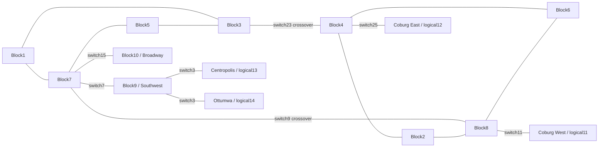

# CTC signalling and interlocking

Baseline: [overview](SYSTEM_OVERVIEW.md). Confirmed behavior below is static source behavior, not a validated railway safety case. Main reference: `CTCLogic.vb`, a single module with global mutable state. There is no separately loaded route database or relay-logic configuration file.

For a non-programmer explanation, see [Signal logic in step-by-step English](SIGNAL_LOGIC_PLAIN_ENGLISH.md). It expands the route tables into numbered checks for all15 wayside signal variables, explaining the code-button process, remembered directions, time release and yardmaster permissions. This technical document retains the compact predicates and implementation detail.

The [point/lock guide](POINT_LOGIC_PLAIN_ENGLISH.md) expands individual acceptance/movement and release rules. The [block guide](BLOCK_LOGIC_PLAIN_ENGLISH.md) explains all detected and boundary records, each traffic memory's set/release rules, ID transfers, detector gating and block line drawings, preserving differences between immediate and delayed point indications.

## Ordered control cycle

`DoOneControlCycle` (`210–274`) increments the cycle-based flash counter, reads all nodes, processes dispatcher controls, sets traffic sticks, commands turnout state, handles electric locks, computes routes east then west, applies time locking, clears traffic sticks, schedules indication codes, updates office/graphical indications, advances road-light timing, decrements timers, applies simulated signal failure and writes all nodes.

While `SignalTest.Visible`, it skips electric locks, both route calculations, time locking, traffic-stick clearing and indication/office/diagram updates. It **still** reads inputs, processes code buttons, sets traffic sticks, runs turnout control and writes field outputs. This is an interlocking bypass for maintenance, not an isolated signal-only subsystem.

Order matters: traffic-stick setting and turnout control precede this cycle's aspect/time-lock updates, while time locking derives from signal indication values calculated later in `Indications`. Several predicates use delayed `K` values. Do not translate this into simultaneous declarative equations without preserving or deliberately reviewing scan-order effects.

## States and timings

| State | Encoding / behavior | Source |
|---|---|---|
| Block | CLR=0,OCC=1,RTD=2; RTD is graphical routing, not detector input | `279–287`; MainPanel block display routines |
| Switch request | LNOR=1,LREV=2; paired motor TUN=1,TUR=2 | `326–342` |
| Signal lever | RIGHT=1,LEFT=2,LSTOP=0 | `354–358` |
| Traffic direction | WEST=1,EAST=2,NDT=0 | `375–377` |
| Lamp pair | NORLT=1,REVLT=2,DARKLT=0 | `362–368` |
| Signal indicator | RIGHTLT=1,STOPLT=2,LEFTLT=4 | `370–373` |
| Time-lock value | NV is the zero-initialized global Integer; direction retained until release | `79–80`; `1580–1624` |

Actual effective delays are **CCDL=2 s, ICDL=2 s, SMDL=10 s, RTDL=10 s, LKDL=10 s**. Earlier assignments 5/10/12/60/90 are overwritten unconditionally by a “debug” block (`CTCLogic.vb:385–396`), including Release builds. The parameter dialog can change four values for this process (`MainPanel.vb:84–92`); no saved configuration or numeric validation is implemented there. Timer expiry is -1; inactive is normally 0, with TMROFF=-1 used for selected purposes. `TimerCount` observes a change in `TimeOfDay.Second` and subtracts one, so stalled loops do not account for all elapsed seconds (`2532–2590`).

## Dispatcher operation and request acceptance

`DoControls` (`918–1207`) latches each pressed CB and serves buttons in fixed station order. An indication code holds off control processing; stacked controls take priority over new indications. Requests are copied from the lever globals **when the control delay completes**, not necessarily at the instant the button was pressed. A rejected request still produces a station recall indication. Signal requests can remain pending until route conditions permit clearance; several former early-rejection checks are commented out.

| Code button | Controlled objects | Active acceptance conditions (in addition to completed code delay) |
|---|---|---|
| CB2 | Gate switch 1 | SWL1 nonzero |
| CB4 | Switch3 / signal4 | BK9 clear; signal request accepted; switch additionally TLV4=NV, SWL3 nonzero |
| CB8 | Switch7 / signal8 | BK7 clear; switch additionally TLV8=NV, SWL7 nonzero |
| CB10 | Switch9 / signal10 | BK8 clear; switch additionally TLV10=NV and TLV8=NV, SWL9 nonzero |
| CB12 | Switch11 / signal12 | BK8 clear; switch additionally TLV10=NV and TLV12=NV, SWL11 nonzero |
| CB16 | Switch15 | BK7 clear, TLV8=NV, SWL15 nonzero |
| CB18 | Lock17 | TLV8=NV, CLL17 nonzero |
| CB20 | Lock19 | TLV10=NV and TLV12=NV, CLL19 nonzero |
| CB24 | Switch23 / signal24 | BK3 clear; switch additionally TLV24=NV, (TLV26=NV or SWL25LT=LREV), SWL23 nonzero and BK4 clear |
| CB26 | Switch25 / signal26 | BK4 clear; switch additionally TLV26=NV, SWL25 nonzero |

Source: `CTCLogic.vb:1070–1199`. Moving a lever alone does not generally transmit a new dispatcher request; pressing its code button starts the process. No implemented fleet input automatically reclears a route after passage.

## Turnout control and physical correspondence

`CTCSwitch` (`1208–1248`) passes each requested state to `PSCTRL`. Gate1 has no occupancy guard; switch3 uses BK9, switches7/9/15 use BK7, switch11 uses BK8, switch23 uses BK3 and switch25 uses BK4. Note switch9 request acceptance tests BK8 but its motor processing tests BK7; both areas affect this crossover.

`PSCTRL` (`1249–1321`) blanks the lamp, sets the normal/reverse motor output and starts SMDL when out of correspondence and its DET block is clear. During the transit delay it does not reconsider correspondence. When time expires it sets the lamp to match the **commanded motor state**, not a measured contact. All actual callers pass MOTOR and zero hand/padlock arguments. Generic dual-control handling exists but is not configured for these calls.

The six TFB inputs are decoded but have no subsequent use in this motor algorithm. Therefore jammed, disconnected or miswired points can receive a “normal/reverse” indication solely after a timer. `SWLI` values are office lock lamps, not independent motor inhibit relays; motor acceptance and occupancy checks supply the actual software restrictions.

**Startup distinction:** on a fresh process, initialization sets requested state, motor command and indication to matching normal values, so PSCTRL does not start its usual movement timer. There is no separate startup point-settling/proving gate. Position-labelled inputs do not prove that Tortoise auxiliary contacts were physically connected. The [startup supplement](STARTUP_INITIALIZATION.md) documents defaults, first output writes, communications failures and the difference between intended Run-first operation and enforced initialization success.

The owner's authoritative clarification is that some points have manual control, while others have software interlocking (16 November 2026). Do not infer that every manual point is software-interlocked. The generic HAND/MOTOR branch being unused by these `PSCTRL` callers does **not** mean the layout lacks manual point control. Source provides local-control/permission examples at turnout 25 and controlled locks 17/19. Which other points are manually controlled, how local switches act on motor/lock circuits, and which feedback or permission paths reach CTC require a physical circuit schedule. This does not establish an independent hardware conflict-protection layer.

### Point-by-point source findings

The table separates a decoded input from an input actually used to enforce a restriction. “No local input found” is a statement about this snapshot, not evidence that a physical manual switch is absent. Every `PSCTRL` call uses MOTOR with zero hand/padlock arguments (`CTCLogic.vb:1225–1247`). The preceding dispatcher request acceptance table supplies the detailed TLV guards.

| Object | Software command / monitored input | Software restriction and manual interaction established by source |
|---|---|---|
| 1 — Centropolis gate | SWL1/CB2 → SM1; UA2 output0/A.0–1; no position feedback decoded | PSCTRL DET=0, no occupancy guard. Code calls this a gate, so do not assume it is a track turnout. No configured local selector input |
| 3 — Southwest | SWL3/CB4 → SM3; TFB3 at UA2 input2/A.0 | BK9 motor guard and TLV4 request guard; route4 depends on commanded/timed indication. TFB3 decoded but unused thereafter; no local command input found |
| 7 — Sheffield | SWL7/CB8 → SM7; TFB7 at UA2 input2/A.1 | BK7 motor guard, TLV8 request guard; route8 alignment checks. TFB7 unused after decoding; no local command input found |
| 9 — Sheffield crossover | SWL9/CB10 → SM9; TFB9 at UA2 input2/A.2 | Request requires BK8 clear and TLV8/TLV10 free; PSCTRL separately guards BK7. Routes8/10 coordinate alignment. TFB9 unused after decoding; no local command input found |
| 11 — Coburg West connection | SWL11/CB12 → SM11; TFB11 at UA2 input2/A.3 | BK8 motor guard, TLV10/TLV12 request guards. SWICW is yardmaster route acceptance, not a decoded manual motor-direction command. TFB11 unused after decoding |
| 15 — Broadway branch | SWL15/CB16 → SM15; TFB15 at UA2 input2/A.4 | BK7 motor guard, TLV8 request guard; affects route8/10 and lock17 release. TFB15 unused after decoding; no local command input found |
| 17 — Sugar Creek controlled lock | CLL17/CB18; calculated UL17; delayed CLL17LTK drives UA2 output0/B.4–5 and0/C.0 | No SM17 motor command or actual point-position input. Unlock denied by TLV8 with SM15 reverse; unlocked indication blocks 8LD. Generic hand-operated-switch lock routine is used, but local key and feedback arguments are not configured. Physical manual actuation/circuit details unknown |
| 19 — Independence controlled lock | CLL19/CB20; calculated UL19; delayed CLL19LTK drives UA2 output0/B.6–7 and0/C.1 | No SM19 motor command or actual point-position input. Release checks TLV10; code acceptance also checks TLV12; unlocked indication inhibits12RA and the normal9 route of10R. Local key/feedback not configured; physical manual actuation details unknown |
| 23 — Freight Line crossover | SWL23/CB24 → SM23; TFB23 at UA2 input2/A.5; duplicate SM23 output pairs at UA3 output0/A.0–1 and4–5 | Request checks BK3/BK4 and TLV24/TLV26 with stated exceptions; PSCTRL guards BK3. Routes24/26 use its alignment. One decoded feedback bit does not prove both crossover motors; TFB23 unused after decoding. No local command input found |
| 25 — Coburg East interface | SWL25/CB26 → SM25; SWI25 at UA3 input2/B.3; TFB25 declared but never read | BK4 motor guard, TLV26 request guard. WriteNode3 changes output0/A.6–7 and0/B.0–1 to allow the local toggle when reverse, according to comments. SWI25 permits the alternate26R route and clears the waiting indicator; it does not replace SWL25R/SM25 with a decoded manual direction. Exact25/25B wiring and what this switch physically proves remain unknown |

Sources: input decoding `CTCLogic.vb:663–674,719–724,764–765`; request acceptance `1070–1199`; motor callers `1225–1247`; local permissions `948–979,1384–1407,1552–1554`; electric locks `1625–1645`; outputs `2990–3017,3045–3074`. Full addresses are in the [I/O mapping](HARDWARE_IO_MAPPING.md).

**Manual-command interaction established:** SWI25 is consumed as a permissive/status input; SWICW changes the Coburg West acceptance state used to clear a signal; dispatcher-controlled locks17/19 restrict routes and energize output paths. No active generic local HAND-selector command path is configured for the powered-point callers. Hardware-side manual overrides elsewhere may exist without a decoded software command; neither their existence nor their safety behavior can be assigned from equipment names alone. Preserve all existing manual/CTC boundaries and obtain explicit approval before proposing added automation or integrations.

## Aspect encoding and route network

Single head: 0 dark,1 green,2 red,3 yellow. KC-specific assignments overwrite earlier generic double-head constants (`CTCLogic.vb:294–324`): GRNRED=6,REDGRN=9,YELRED=14,REDYEL=11,REDRED=10. This reverses the generic double-head field convention; retain the final assignments. Triple heads: all red=2A hex, green/red/red=1A, red/green/red=26, red/red/green=29, with yellow variants 3A/2E/2B. Signal names A/B/C do not provide a physical mast wiring certificate.

The route functions explicitly reset each signal group to red before testing clearance. They mostly implement **route selection by green on the appropriate head**, rather than a general multi-block speed/approach signalling engine. Yellow is actively used for 26LC when BK2 is occupied; many declared yellow/flash variables have no active normal route use. Signal-left routes are calculated by `RouteCheckEast`; signal-right routes by `RouteCheckWest`, despite misleading east/west header comments elsewhere.

The following table records the active route predicates. N/R mean `SWLxxLT=NORLT/REVLT`; “corresponding” means the software lamp is nonzero, **not actual points proven**. Every row also requires its own signal lever request L or R. Every named occupied block prevents clearance except the explicitly allowed BK2 yellow condition.

| Signal | Common restrictive checks | Cleared route/aspect |
|---|---|---|
| 4LAB (L) | 3 corresponding; BK9 clear; FS9 not WEST | 3N → G/R; otherwise R/G |
| 8LABC (L) | 7,9,15 corresponding; BK7 clear; TLV8 not RIGHT; 15N; if 7R FS9 not WEST; if 7N9N FS5 not WEST; if 9R BK8 clear and FS6 not WEST | 7N9N → G/R/R; 9R → R/G/R; 7R9N → R/R/G |
| 8LD (L) | 7,9,15 corresponding; BK7 clear; TLV8 not RIGHT; 15R; lock17 not reverse; if 9N FS5 not WEST; if 9R FS6 not WEST and BK8 clear; if 7R FS9 not WEST; TrainID(10) nonempty | G; clears Broadway request annunciator |
| 10LAB (L) | 11,9 corresponding; BK8 clear; reject 9R11N; TLV10 not RIGHT; FS6 not WEST | 11N → G/R; 11R and CWSTATUS=YardAccept → R/G |
| 24LA (L) | 23 corresponding and N; BK3 clear; TLV24 not RIGHT; FS1 not WEST | G |
| 26LAB (L) | 23,25 corresponding; BK4 clear; 25N; if 23N TLV26 not RIGHT and FS2 not WEST; if 23R TLV24 not RIGHT and FS1 not WEST | 23N → G/R; 23R → R/G |
| 26LC (L) | 25 corresponding and R; BK4 clear; TLV26 not RIGHT; TrainID(12) nonempty | BK2 occupied → Y, otherwise G; clears Coburg East request |
| 4RA / 4RB (R) | 3 corresponding; BK9 clear; TLV4 not LEFT; reject TLV8=LEFT with 7R9N | 3N and TrainID(14) → RA G; otherwise TrainID(13) → RB G |
| 8RAB / 8RC (R) | 7,9,15 corresponding; BK7 clear; 9N; TLV8 not LEFT; if 15N FS1 not EAST | 7R → RC G; 7N15N → AB G/R; 7N15R → AB R/G |
| 10RABC (R) | BK8 clear; 11,9,15 corresponding; reject 9N11R; if 9N TLV10 not LEFT, FS2 not EAST, lock19 not reverse; if 9R TLV8 not LEFT, and with 15N FS1 not EAST | 9N11N → G/R/R; 9R15N → R/G/R; 9R15R → R/R/G |
| 12RA (R) | BK8 clear; 11 corresponding and R; TLV10 not LEFT; FS2 not EAST; lock19 not reverse; TrainID(11) nonempty | G; clears Coburg West request |
| 24RAB (R) | BK3 clear; 23 corresponding; if 23N TLV24 not LEFT, FS5 not EAST; if 23R reject TLV26=LEFT with 25N and reject FS6=EAST | 23N → G/R; otherwise R/G |
| 26RAB (R) | BK4 clear; TLV26 not LEFT; 25 corresponding; if 25N FS6 not EAST | 25N23N → G/R; otherwise SWI25=1 → R/G |

Sources: `RouteCheckEast`, `CTCLogic.vb:1322–1449`; `RouteCheckWest`, `1450–1559`. These are predicates as written; absence of a check in a row must not be filled in from a presumed symmetrical design. For example, 26R's alternate branch is “otherwise” after the combined 25N23N test, not an explicit 25R test.

## Traffic direction memory and conflict prevention

`SetTrafficSticks` (`768–917`) latches FS1–FS10 from cleared signals/TLVs, selected point positions and, for FS10, a train ID. These remember direction beyond a momentary clear signal. `ClearTrafficSticks` (`2597–2841`) releases only under route-specific combinations of clear blocks, no remaining signal/time lock and turnout alignment. This is route-dependent state memory, not a simple `FS=occupancy` calculation.

| Stick | Territory represented by source relationships |
|---|---|
| FS1/FS2 | North/south mains between Rock Creek and Freight Line |
| FS3/FS4 | Freight Line interlocking blocks3/4; crossover23 links both |
| FS5/FS6 | North/south mains between Sheffield and Freight Line |
| FS7/FS8 | Sheffield/Rock Creek blocks7/8; crossover9 links both |
| FS9 | Southwest Junction block9 |
| FS10 | Broadway approach block10 / switch15 branch |

A simplified **logical adjacency**, derived from `UpdateTrainIDs:2234–2455`, is below. It is not to scale and does not specify signal facing or exact detector boundaries.

## Cancellation, time locking and electric locks

`TimeLocking/TLVPRO` (`1560–1624`) sets directional TLV from signal indication, clears TLV and sets lever request to stop on OS occupancy, and runs RTDL if a previously cleared lever is coded back to stop. Only after expiry is TLV released for incompatible moves. Thus cancellation is a coded stop request plus time release; closing a window is not cancellation. TLV4 uses BK9/timer11; TLV8 BK7/12; TLV10 BK8/13; TLV12 BK8/21; TLV24 BK3/14; TLV26 BK4/15.

`SwitchLock` (`1625–1647`) invokes `CNTLELOCK` for Sugar Creek17 and Independence19. NOREL for17 is set by TLV8 with SM15 reverse; for19 by TLV10 in either direction. The actual callers pass BKT=CLR and TFB=0 and reuse dispatcher request as local request; there is no local key input configured. Timed-occupancy release and feedback branches in the generic helper therefore do not demonstrate actual field protection. `AUTOELOCK` (`1648–1712`) is present but has no active caller.

Physical lock command outputs are derived from delayed panel values (`WriteNode2`), adding another distinction between calculated `UL` and hardware drive. These circuits require original schematics before energization.

## Occupancy, yard and train identities

Detectors drive BK1–BK10; `Indications` (`1789–2109`) copies these into TL values, snapshots a station's values in TSTORE, waits ICDL then updates `K` panel values. Office direction and lock lamps are separately computed (`2110–2233`). The screen mixes raw BK values held during indication transmission with delayed signal/switch indicators; it is a dispatcher presentation, not an independent safety monitor (`MainPanel.vb:648–686`).

Coburg West accepts a reverse switch11 route only after the yardmaster's SWICW acceptance changes CWSTATUS from TrainWaiting to YardAccept. Occupancy then marks TrainInBlock and clearance releases it (`DoControls`, `RouteCheckEast`, `OfficeIndications`). Coburg East uses the local turnout25 switch SWI25 to permit the alternate 26R route. Field departure buttons latch annunciators; reset clears them; successful selected routes clear corresponding requests.

Train/loco IDs are manually entered and propagated between occupied adjoining blocks according to direction and delayed point indications. IDs are not transponder or DCC feedback. `MoveTrain` will not overwrite a populated destination; source IDs are cleared on detector clearance or boundary transitions. OS logs are generated for blocks3/4/7/8/9. The effective undetected boundary indices are **11 Coburg West,12 Coburg East,13 Centropolis,14 Ottumwa**. An older declaration comment at line200 gives different names; executable handlers at `MainPanel.vb:1329–1355` and move logic take precedence. Broadway uses detected block10; slot15 has no comparable active boundary workflow.

Train IDs are operational preconditions for 4RA/4RB,8LD,12RA,26LC, so identity tracking is not merely decorative. `MainPanel.lblCoburgWest_Click` at 795–802 only edits a label/log; the track-line handler calling `InputTrainID` writes the actual array. Confusing these UI actions can leave a requested signal at stop.

## Protection assessment and restoration-critical findings

| Finding | Evidence and practical implication |
|---|---|
| Software does substantial interlocking | Routes, sticks, timed locking and motor request guards are implemented here; no evidence establishes an independent hardware interlocking layer |
| Lost communications are not made restrictive | `ReadRailroad` ignores error returns and unpacks shared IB; no unknown/failed occupancy state. Initial BK defaults are zero/clear |
| Point correspondence is inferred from time | TFB contacts unused by PSCTRL; a stall can appear correctly aligned |
| No safe pause/exit transaction | `MainPanel.vb:22–32,57–61` disables the loop or invokes End; no restrictive output write or verified power removal |
| Startup can move points | `InitializeControls` starts all SM normal; first live cycle writes them |
| Short timings are live | Unconditional debug overrides, not Debug-only compilation |
| Maintenance bypass | `SignalTest.Visible` skips normal protections but still writes outputs |
| Shared output contamination | `WriteNode3` does not define OB6 except for yellow; inherits node2 signal4 byte otherwise |
| Hardware workaround documented | Dead output transistor substitution in `WriteNode3:3068–3069`; physical status unknown |
| Restart is not a complete state reset | Several globals such as code scheduling/TLV/timers are not all explicitly cleared by InitializeControls; `InitializeConstants` also declares a local TD shadow. Repeated Run during one process needs validation |
| Power loss holds old occupancy | No forced occupied/unknown state; PWRIND tests entire byte for exact value 1 |

**Conclusion:** signalling and route interlocking are demonstrably implemented in software; hardware participates through detectors, drivers, local switch/permission circuits and locks, but independent hardware conflict protection is unknown. Do not claim either “all interlocking is hardware” or “hardware has none.” No emergency stop/failsafe behavior is proven by this repository.
