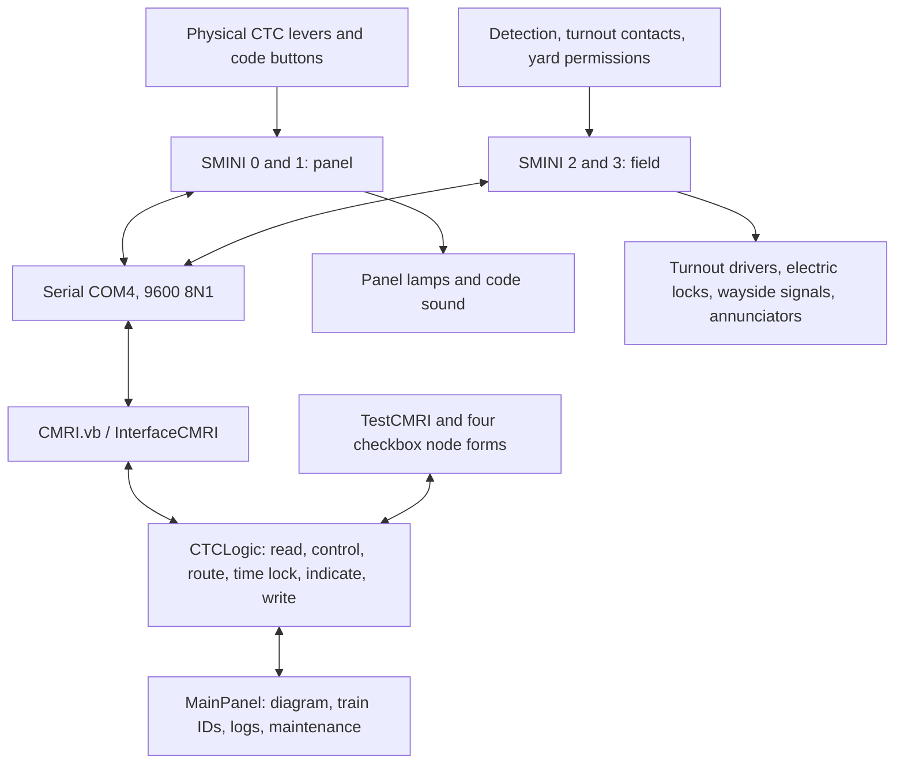

# Kansas City Sub CTC — Phase 1 audit

Audit date: 16 November 2026. Source: [Egore990/Kansas-City-Sub-CTC](https://github.com/Egore990/Kansas-City-Sub-CTC), baseline commit `0a561b3f8de459a787795a16da4c987868d4ae79` (17 July 2016). This documentation is published on the separate `audit/phase-1-technical-audit` branch; the original application files remain unchanged. Source filenames are relative to the repository root. All source line references refer to the baseline commit, counted from one. This is a static engineering audit, not a statement of operational fitness.

## Executive findings

The repository preserves a substantial, apparently coherent Visual Basic Windows Forms CTC application, not a complete railway automation suite. It reads a physical dispatcher panel, ten block detectors, selected turnout contacts and yard requests through four SMINI nodes. It implements route signalling, simulated control/indication code delays, software time locking, turnout commands, electric-lock commands, train identification, annunciators and a 6:1 fast clock. It writes both panel lamps and field signals. The same control loop can instead use checkbox-based SMINI simulators.

Most of that functionality appears recoverable. A build has **not** been attempted, and neither compilation nor correct hardware operation is established. The main missing build dependency is Microsoft Visual Basic PowerPacks 12.0; a missing project-only image is also recorded. The repository history contains older binaries and a PowerPacks DLL, but those are not authenticated last-operational releases. See [inventory](SOURCE_CODE_INVENTORY.md).

The main engineering risks are ignored communications failures, stale/shared input and output buffers, time-based rather than measured turnout correspondence, shortened debug delays, maintenance overrides and no demonstrated stop-on-disconnect policy. These matter more than merely getting the program to launch. The software is an operational reference; it is not demonstrated failsafe interlocking.

The current priority is **Option A: recover and behaviorally verify an isolated original-application baseline**, beginning with the available GitHub source. Modernization remains a later option, not the next approved action. Reported2018 backups may change baseline selection after comparison; no historical version is yet established as the final operational release. A replacement or JMRI migration would require reproducing considerable railway-specific behavior. No implementation is authorized. See [options](RESTORATION_OPTIONS.md), [backup discovery](HISTORICAL_BACKUPS.md) and [roadmap](RESTORATION_ROADMAP.md).

## Document index

1. [Source inventory and build completeness](SOURCE_CODE_INVENTORY.md)
2. [C/MRI communications](CMRI_COMMUNICATIONS.md)
3. [Hardware I/O mapping](HARDWARE_IO_MAPPING.md)
4. [CTC signalling and interlocking](CTC_INTERLOCKING.md)
5. [Maintenance tools](MAINTENANCE_TOOLS.md)
6. [Simulation capabilities](SIMULATION_CAPABILITIES.md)
7. [Restoration options](RESTORATION_OPTIONS.md)
8. [Missing information](MISSING_INFORMATION.md)
9. [Restoration roadmap](RESTORATION_ROADMAP.md)

Supplement: [Startup initialization and turnout position tracking](STARTUP_INITIALIZATION.md). This traces the available Run command, records the unresolved “Start Layout” name, lists defaults and distinguishes ordinary movement timing from the absence of a fresh-start settling gate.

Project update: [Historical backups and comparison plan](HISTORICAL_BACKUPS.md) records the unavailable2018 candidates and their evidence status. [Proposed Phase 2 build and simulation plan](PHASE_2_BUILD_SIMULATION_PLAN.md) defines prerequisites, approval gates and future evidence; it has not been executed.

## Evidence convention and scope

**Confirmed** means directly present in this source snapshot or its Git metadata. **Inference** means an engineering conclusion from the implementation. **Unknown** means this repository cannot establish it. Historical/user descriptions are kept distinct from code findings. Comments and simulator labels can be stale: executable pack/unpack statements take precedence for software mapping, and none proves the installed wiring.

For new backup evidence, distinguish owner-confirmed context, owner recollection, reported screenshot observations and unverified hypotheses as defined in [the evidence register](HISTORICAL_BACKUPS.md#evidence-labels). Codex has not inspected the OneDrive files or the described screenshots. Approximate2018 filenames, sizes and dates are reported observations, not file-level verification.

**Authoritative owner clarification (16 November 2026; supersedes earlier assumptions):** day/night lighting was installed by the current owner after purchasing the railway and is excluded from initial software restoration. EasyDCC operates independently of C/MRI and CTC; track detectors provide occupancy information to CTC, and no DCC command integration is to be planned. The turntable is manually controlled by a physical switch at the side of the layout and requires no software integration. Some points have manual control, while others have software interlocking; which functions overlap must be established from source and wiring, not assumed. Absence of EasyDCC, turntable or day/night control code is not evidence of missing CTC software. Preserve these boundaries; new automation or integrations require explicit approval.

Inspected material includes the current tracked source, form designers, resource/configuration XML, project and solution, notes, asset references, reachable commit history and relevant historical changes/deletions. Historical executables and binary IDE state were identified, not run or treated as source. No compile, application execution, automated behavioral test, dependency installation, physical communication, deployment or source edit occurred. Static checks of paths, XML, reference coverage and documentation are not application tests.

## Owner-reported hardware condition

The original PC was damaged by lightning. The owner also reports prolonged moisture from water beneath the floor/carpet, visibly warped timber supporting the CTC machine, separate5 V/12 V distribution and a previously replaced failed electrical unit. The affected unit and current C/MRI/electronics condition are not established; no comprehensive recent electrical testing is reported. Do not assume serviceability. Any future authorized hardware recommissioning starts with inspection, isolated supply tests and individual board testing, separately from software simulation. The owner identifies Tortoise motors but believes continuous position feedback was absent; actual contact wiring still requires verification.

## Architecture

The simulator and real transport are alternatives selected by menu; they are not two independent CTC implementations. Entry point is `My Project/Application.Designer.vb:34–35` (`OnCreateMainForm`); the main form selects the backend (`MainPanel.vb:39–55`). The actual ordered loop is `CTCLogic.vb:210–274`.

## Historical railway description checked against code

| Description | Code finding | Confidence/limit |
|---|---|---|
| C/MRI and SMINI | Four nodes, addresses 0–3, each 24 inputs/48 outputs | Confirmed configuration; installed population unknown |
| Physical CTC dispatcher panel | Two-bit switch/signal levers and ten code buttons; many lamp outputs | Confirmed (`ReadRailroad`, `WriteNode0/1`) |
| Occupancy detection | `BK1`–`BK10`, power-gated reads | Confirmed; detector models and boundaries unknown |
| Signals and turnouts interlocked | Software checks, traffic sticks, time locks and electric lock handling | Confirmed software; hardware protection unknown |
| Tortoise motors | Explicit two-line stall-motor constants/comments; paired output commands | Software intended for Tortoise; driver wiring/current capability unverified |
| Yardmaster and dispatcher | Coburg yard permission/acceptance, turnout 25 local switch, departure requests | Confirmed; no separate yardmaster network client |
| Crew operation in dark territory | Manual train entry and undetected boundary blocks | Consistent with description; no complete dark-territory control program |
| EasyDCC | No EasyDCC driver, throttle commands or second train-control link found | Owner confirms standalone train control; track detectors interface occupancy to CTC |
| Classification yard | Coburg interfaces exist; no full yard ladder controller found | Manual control and software interlocking exist on some points; their exact overlap needs mapping |
| Turntable | No turntable indexing/controller code found | Owner confirms manual control by a switch at the side of the layout; software controller is not a missing requirement |
| 5 V/12 V distribution | A 12 V comment for turnout 25 and power indication exist | Distribution design and supplies not specified |
| 12 V day/night lighting | No implemented day/night dimmer or schedule found | Owner confirms a later addition; road traffic-light code is a different function |
| Vista then Windows 7 | WinForms/.NET 4 target is consistent with that era | Operating history not independently established |
| Multiple operators | Physical requests and permissions support roles | No accounts, remote dispatch server or multiuser software architecture found |

## Practical first milestone

After audit review and explicit build/test approval, reproduce a **hardware-disconnected simulator baseline** with recorded toolchain/dependencies and representative normal, conflicting, cancelled and occupied routes. In parallel, gather photographs, wiring diagrams and the last working PC/archive. Do not make the first milestone a live turnout movement. Hardware recovery should follow independent electrical inspection and reconciliation of every connected output.
